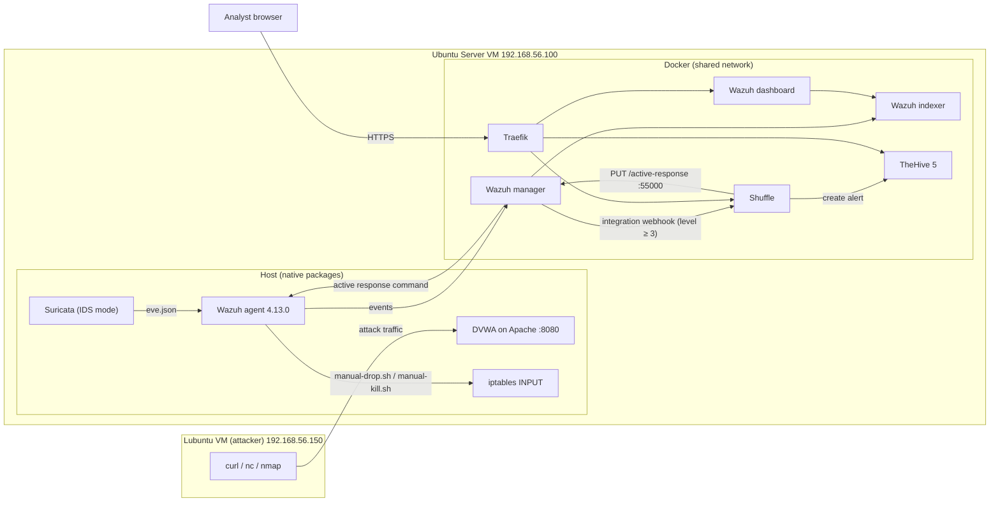
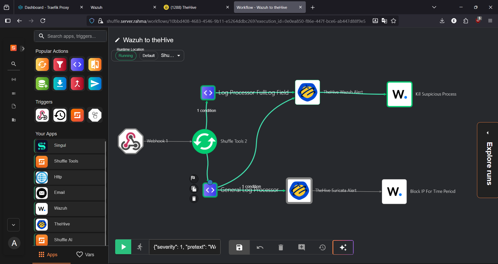

# SOC-SOAR Lab: Suricata → Wazuh → Shuffle → TheHive

A homelab that detects attacks with Suricata and Wazuh, forwards alerts to Shuffle, and uses Shuffle to open alerts in TheHive and trigger Wazuh active responses (a temporary IP block and a process kill).

Built and tested in October 2025 on VirtualBox. **The environment has since been torn down.** This repository is an archive of the configuration as it ran, with screenshots and demo videos as evidence. It is not a one-command deployment; see [Known limitations](#known-limitations-and-lab-trade-offs).

**Headline result (IP-ban demo):** a reverse shell opened through a DVWA command injection was detected by Suricata (ET Open signature), and the attacker's IP was dropped by iptables after the Wazuh alert was raised. The attacker's shell stopped responding before `whoami` returned.

---

## Architecture



Suricata sniffs the server's network interface. It runs in IDS mode, so it observes traffic but does not block it; blocking is done by the Wazuh active response scripts.

### Alert path, in order

1. Suricata matches traffic against ET Open rules and writes the alert to `/var/log/suricata/eve.json`.
2. The Wazuh agent on the same host reads `eve.json` (`log_format json`) and forwards it to the manager.
3. The manager decodes it with the built-in JSON decoder; base rule **86601** raises `Suricata: Alert - <signature>`.
4. The manager's `<integration>` block posts every alert of level 3 or higher to a Shuffle webhook.
5. The Shuffle workflow cleans the payload, creates a TheHive alert, and for matching alerts calls the Wazuh API to run an active response on agent `001` (workflow details below).
6. The agent runs `manual-drop.sh` (iptables block for N seconds) or `manual-kill.sh` (`kill -9` on the PID found in the alert's `full_log`).

### Shuffle workflow ("Wazuh to theHive")



| Path | Nodes |
|---|---|
| Top | `Webhook 1` → `Shuffle Tools 2` → (condition) `Log Processor FullLog Field` → `TheHive Wazuh Alert` → `Kill Suspicious Process` (Wazuh app) |
| Bottom | `Shuffle Tools 2` → `General Log Processor` → (condition) `TheHive Suricata Alert` → `Block IP For Time Period` (Wazuh app) |
| Cross-link | `General Log Processor` → `TheHive Wazuh Alert` |

The two processor nodes run a short Python step that replaces double quotes inside `full_log` and `text` with single quotes. Without it, Wazuh log lines that contain quotes produced invalid JSON in the TheHive request body. The Wazuh app nodes call `PUT /active-response` on `https://192.168.56.100:55000` with the command name (`manual-drop0` or `manual-kill0`), the arguments, and the full alert.

---

## Components and versions

| Component | Role | Runs as | Version |
|---|---|---|---|
| Suricata | Network IDS, ET Open rules, writes `eve.json` | Host package | 8.0.1 |
| Wazuh agent | Ships `eve.json`, syslog/journald, SCA results; executes active responses | Host package | 4.13.0 |
| Wazuh manager | Rules, alerting, integration, active response, API on 55000 | Docker | 4.13.0 |
| Wazuh indexer | Alert storage | Docker | 4.13.0 |
| Wazuh dashboard | Alert UI | Docker | 4.13.0 |
| Shuffle | SOAR workflows (webhook trigger, TheHive and Wazuh apps) | Docker (`config/shuffle/shuffle-compose.yml`) | Latest |
| TheHive | Alert and case management | Docker (`config/thehive/compose.yml`) | 5.1 |
| Traefik | Reverse proxy, TLS termination (self-signed certificate) | Docker | v3 |
| DVWA | Deliberately vulnerable web app (target) | Host, Apache on port 8080 | Any |

## Hosts

| VM | OS | Network | Resources | Role |
|---|---|---|---|---|
| Ubuntu Server | Ubuntu Server | 192.168.56.100 (VirtualBox host-only), 192.168.186.100 (NAT Network) | ~12 GB RAM, 6 vCPU, 50 GB disk | SOC stack, DVWA, Suricata, Wazuh agent |
| Lubuntu | Lubuntu (ANY) | 192.168.56.150 | Any | Attacker |

Hypervisor: VirtualBox on a Windows 11 laptop.

---

## Demos


| # | Demo | Type | Trigger | Wazuh rule / signature | Video |
|---|---|---|---|---|---|
| 0 | IP ban | Response | DVWA command injection → reverse shell → `manual-drop.sh` blocks the attacker | 86601: `ET ATTACK_RESPONSE Interactive Reverse Shell Without TTY (Outbound)` | <a target="_blank" href="https://drive.google.com/file/d/17Ls7vQjWFF-7JoSkQeVVB0K0HCaqbQxd/view" >Drive Link</a> |

### IP-ban demo: MITRE ATT&CK mapping

| Step | Technique |
|---|---|
| Command injection in DVWA's "Ping a device" form | T1190 Exploit Public-Facing Application |
| `bash -i` reverse shell to the attacker | T1059.004 Unix Shell |
| Callback to port 4444 | T1571 Non-Standard Port |
| `whoami` in the shell | T1033 System Owner/User Discovery |

---

## Repository layout

```text
.
├── README.md
├── .gitignore
├── docker-compose.yml                 # Wazuh single-node stack (credentials via .env files)
├── generate-indexer-certs.yml         # Wazuh's certificate generator
├── .env.manager.example
├── .env.indexer.example
├── .env.dashboard.example
├── config/
│   ├── certs.yml                      # node names for the certificate generator
│   ├── wazuh_cluster/
│   │   └── wazuh_manager.conf.example # ossec.conf: integration, command, active-response
│   ├── wazuh_indexer/
│   │   ├── wazuh.indexer.yml
│   │   └── internal_users.yml.example
│   ├── wazuh_dashboard/
│   │   ├── opensearch_dashboards.yml.example
│   │   └── wazuh.yml.example
│   ├── thehive/
│   │   ├── compose.yml
│   │   ├── application.conf.example
│   │   ├── logback.xml
│   │   ├── .env.db.example
│   │   └── .env.thehive.example
│   ├── traefik/
│   │   └── dynamic/tls.yml
│   ├── wazuh_active-response/         # copied to the agent (host), not mounted into Docker
│   │   ├── manual-drop.sh
│   │   └── manual-kill.sh
│   └── shuffle/
│       ├── shuffle-compose.yml
│       ├── .env.example
│       ├── .env.backend.example
│       └── .env.opensearch.example
└── docs/
    ├── shuffle-workflow.md
    └── screenshots/
```

Not in this repository, by design: TLS keys and certificates, real `.env` files, Shuffle's database and file storage, and Shuffle's own source code (the build used the upstream project; see the version table).

---

## How it was built

The steps below follow the order the lab was built in. Each phase has a screenshot folder under `docs/screenshots/`.

### 1. Suricata (host)

Installed as a host package and configured with the server's interface and `HOME_NET`, with JSON alert output to `/var/log/suricata/eve.json`. Rules: ET Open. No custom Suricata rules were written.

### 2. Wazuh single-node stack (Docker)

```bash
cp .env.manager.example .env.manager
cp .env.indexer.example .env.indexer
cp .env.dashboard.example .env.dashboard
# fill in real values

docker compose -f generate-indexer-certs.yml run --rm generator
docker compose up -d
```

The Wazuh indexer also requires `vm.max_map_count=262144` on the host (see Wazuh's Docker documentation).

### 3. Traefik

Traefik terminates HTTPS for the three web UIs (Wazuh dashboard, Shuffle, TheHive) by hostname, using a self-signed certificate referenced in `config/traefik/dynamic/tls.yml`. Generate your own certificate:

```bash
openssl req -x509 -newkey rsa:4096 -nodes -days 365 \
  -keyout config/traefik/certs/key.pem \
  -out config/traefik/certs/cert.pem \
  -subj "/CN=*.soc.lab"
```

### 4. TheHive

```bash
cp config/thehive/application.conf.example config/thehive/application.conf
cp config/thehive/.env.db.example config/thehive/.env.db
cp config/thehive/.env.thehive.example config/thehive/.env.thehive
docker compose -f config/thehive/compose.yml up -d
```

### 5. Wazuh agent (host)

Wazuh agent 4.13.0 installed on the Ubuntu host and enrolled with the manager (agent ID `001`). It reads Suricata's output with:

```xml
<localfile>
  <log_format>json</log_format>
  <location>/var/log/suricata/eve.json</location>
</localfile>
```

(Reconstructed; this block was not captured in a screenshot.)

### 6. Shuffle

```bash
cd config/shuffle
cp .env.example .env
cp .env.backend.example .env.backend
cp .env.opensearch.example .env.opensearch
docker compose -f shuffle-compose.yml up -d
```

The workflow was built by hand in the Shuffle UI and never exported. [`docs/shuffle-workflow.md`](docs/shuffle-workflow.md) describes each node so it can be rebuilt.

### 7. Wazuh → Shuffle integration

In the manager's `ossec.conf`:

```xml
<integration>
  <name>shuffle</name>
  <hook_url>http://frontend/api/v1/hooks/webhook_<WEBHOOK_ID></hook_url>
  <level>3</level>
  <alert_format>json</alert_format>
</integration>
```

The manager reaches Shuffle by its Docker service name (`frontend`) on the shared Docker network. The host IP does not work here, because those ports were not published to the host.

Two manager-side settings were needed:

```bash
# /var/ossec/etc/local_internal_options.conf
# Suricata HTTP alerts carry more JSON fields than the decoder's default limit
analysisd.decoder_order_size=1024
```

```bash
# Wazuh API token lifetime, raised to 14 days so Shuffle's stored token stays valid
echo "auth_token_exp_timeout: 1209600" >> /var/ossec/api/configuration/security/security.yaml
/var/ossec/bin/wazuh-control restart
```

### 8. DVWA

Installed natively on the host under Apache, listening on port 8080, security level set to `low`.

### 9. Active response

On the agent (host):

```bash
cp config/wazuh_active-response/manual-*.sh /var/ossec/active-response/bin/
chown root:wazuh /var/ossec/active-response/bin/manual-drop.sh /var/ossec/active-response/bin/manual-kill.sh
chmod 750 /var/ossec/active-response/bin/manual-drop.sh /var/ossec/active-response/bin/manual-kill.sh
```

On the manager:

```xml
<command>
  <name>manual-drop</name>
  <executable>manual-drop.sh</executable>
  <timeout_allowed>yes</timeout_allowed>
</command>

<active-response>
  <command>manual-drop</command>
  <location>local</location>
</active-response>
```

Check that both responses are registered (run inside the manager container):

```text
# /var/ossec/bin/agent_control -L
   Response name: manual-drop0, command: manual-drop.sh
   Response name: manual-kill0, command: manual-kill.sh
```

The API call from Shuffle uses the registered name `manual-drop0`, with the target IP and duration (seconds) as arguments. `manual-drop.sh` reads them from `.parameters.extra_args[0]` and `[1]` on stdin.

---

## Known limitations and lab trade-offs

**Not reproducible as-is.** The lab was torn down before the Shuffle workflow was exported, so it has to be rebuilt by hand from `docs/shuffle-workflow.md`. Configuration files are snapshots of what ran, with credentials removed.

**Single VM.** The SOC stack, the monitored host, and the vulnerable app all run on one Ubuntu VM. In a real deployment the SIEM/SOAR would sit on separate infrastructure from the hosts it protects.

**Self-signed TLS, single-node Wazuh.** No high availability, no real certificate authority.

**Detection uses stock rules.** Wazuh's default ruleset and Suricata ET Open signatures. No rule tuning or custom detection was done for the demos.

**Alert volume.** The integration forwards everything at level 3 or above, so TheHive also received routine events (PAM sessions, sudo). TheHive held over 1,000 alerts after the demo runs.

**Duplicate TheHive alerts.** The `General Log Processor` node feeds both `TheHive Suricata Alert` and `TheHive Wazuh Alert`, so each Suricata event created two TheHive alerts (types `Suricata Alert` and `Wazuh Alert`) with the same `sourceRef`. TheHive deduplicates on type + source + sourceRef, so the different types let both through.

**The kill step runs on more alerts than intended.** Because of the same cross-link, alerts on the Suricata branch also reach `Kill Suspicious Process`. For Suricata alerts `manual-kill.sh` finds no `pid=` and exits, but the path is wider than the process-kill scenario needs.

**The server blocked its own IP.** For "Outbound" signatures the attacker is the destination, so the Block IP step passes both `src_ip` and `dest_ip`. As a result, the server's own address (192.168.56.100) was also added to its INPUT chain.

**Repeated blocks.** Suricata captures packets before netfilter's INPUT chain, so it keeps alerting on traffic that iptables has already dropped (the `whoami` alert arrived 4 seconds after the block). During the IP-ban demo, `manual-drop.log` shows the block being removed and re-added every 60 seconds for at least 12 minutes. The exact cause was not confirmed before teardown.

**`manual-drop.sh` gaps:**
- no validation of the IP argument
- `iptables -A` appends after any existing ACCEPT rules
- repeated alerts can stack duplicate rules
- the unblock is a background `sleep`, so an agent restart leaves the block in place permanently

**`manual-kill.sh` gaps:**
- it kills any PID found in `full_log`, with no check on user, process name, or rule ID
- `grep -oP 'pid=\K[0-9]+'` also matches inside `ppid=`, so a log line containing both yields two values and the kill fails
- it uses `kill -9` with no attempt at a graceful stop

**Wazuh API access.** Shuffle uses the `wazuh-wui` account (administrator role) with a 14-day token. A production setup would use a dedicated API user limited to active response, with a fresh token requested per run.

**IDS only.** Suricata does not block; containment depends on the Wazuh → Shuffle → API → agent round trip (8 seconds in the IP-ban demo).

---

## Next steps

- Export the Shuffle workflow as JSON (sanitized) so the lab can be rebuilt without screenshots.
- Never block the lab's own addresses: a Wazuh `<white_list>`, plus selecting the attacker IP as whichever side is outside `HOME_NET`.
- Restrict `manual-kill.sh` to specific rule IDs and processes, match `\bpid=` only, and route only the process-kill rule to it.
- Rework `manual-drop.sh` to:
  - use `iptables -I`
  - skip IPs that are already blocked
  - use Wazuh's stateful active response (`check_keys`) and the execd timeout instead of a background `sleep`
- Create a dedicated Wazuh API user with an active-response-only role, and request a short-lived token per run.
- Narrow what goes to TheHive (higher integration level or rule-group filter) and fix the duplicate-alert branch.
- Write custom Wazuh rules with MITRE ATT&CK mappings for the demo scenarios.
- Add enrichment (e.g. Cortex analyzers) for TheHive observables.

---

## Security note

This repository contains no credentials. Every file that held one is published as a `.example` template with placeholder values. Copy it, fill in your own values, and keep the real file out of git (see `.gitignore`).

## Related

- Blog post: <a target="_blank" href="https://portfolio.ycnbase.com/posts/soc-soar-lab">link</a> to portfolio post
- tektoSync, an OpenShift GitOps blueprint: <a target="_blank" href="https://github.com/Yassine-Rejeb/tektoSync-The-Cloud-Native-Delivery-Blueprint" >link</a>
